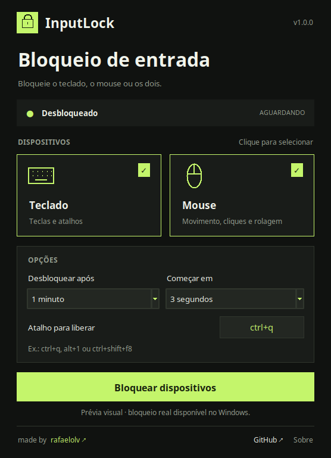

<p align="center">
  
</p>
<h1 align="center">InputLock</h1>
<p align="center">Bloqueio temporário de teclado e mouse para Windows.</p>
<p align="center"><a href="https://github.com/rafelolv/InputLock/releases">Baixar para Windows</a> · <a href="https://github.com/rafelolv">made by rafaelolv</a></p>



## O que tem

- Interface em português, tema escuro e ícone próprio.
- Teclado, mouse ou ambos: escolha antes de bloquear.
- Contagem de 0, 3 ou 5 segundos, cancelável com Esc.
- Desbloqueio automático após 30 segundos, 1, 5 ou 15 minutos; opção sem limite.
- Atalho personalizável, padrão `Ctrl + Q`.
- Emergência fixa: `Ctrl + Alt + F12` libera os dois dispositivos.
- Preferências em `%APPDATA%\InputLock\settings.json`.
- Sem dependências externas em execução, contas, telemetria ou registro de teclas.

## Usar

1. Baixe `InputLock.exe` na release e abra. Não precisa instalar Python.
2. Selecione os dispositivos e escolha a duração.
3. Confira o atalho e clique em **Bloquear dispositivos**.
4. Para liberar, use o atalho ou aguarde o temporizador. Se o mouse estiver disponível, também há **Desbloquear agora**.

`InputLock-Setup.exe` é o instalador opcional por usuário, sem exigir administrador.

O app atua na sessão atual do Windows 10/11 x64. Não é um bloqueio de segurança da sessão: para isso, use `Win + L`. `Ctrl + Alt + Del` permanece disponível. Aplicativos elevados e áreas protegidas do Windows podem não ser bloqueados. Fechar o app libera os dispositivos. O temporizador funciona numa thread independente da interface.

## Rodar pelo código

Python 3.11 ou superior com Tkinter. No Windows, o instalador oficial do Python inclui Tkinter por padrão.

```powershell
py -3 main.py
```

Prévia visual, sem bloquear dispositivos (também funciona no Linux com Tkinter):

```sh
python3 main.py --preview
```

## Compilar no Windows

```powershell
py -3 -m pip install -r requirements-build.txt
py -3 build.py
```

Ou execute `build.bat`. Resultado: `dist/InputLock.exe`, portátil, com ícone e metadados. Para o instalador, compile `InputLock.iss` com Inno Setup 6:

```powershell
& "${env:ProgramFiles(x86)}\Inno Setup 6\ISCC.exe" InputLock.iss
```

O executável Windows é compilado no Windows. `build.sh` informa essa restrição quando executado no Linux.

### GitHub Actions e releases

O workflow **Windows build** testa e compila em pushes para `main`, pull requests e execução manual. Baixe o artefato **InputLock-Windows-x64** na aba Actions. Ele contém:

- `InputLock.exe`: portátil.
- `InputLock-Setup.exe`: instalador.
- `InputLock-Source.zip`: código correspondente à compilação.
- `SHA256SUMS.txt`: checksums dos arquivos.

Ao enviar uma tag `v*`, o workflow compila e publica a release com os arquivos e as notas de `RELEASE_NOTES.md`. Também anexa os arquivos a releases publicadas manualmente. Mantenha a versão de `main.py`, `InputLock.iss` e `version_info.txt` alinhada à tag. Fazer push apenas em `main` gera o artefato, sem publicar release.

## Verificar

```sh
python3 -m unittest discover -s tests -v
python3 main.py --smoke-test
```

Testes cobrem atalhos, modificadores dos dois lados, desbloqueio de emergência, temporizador e preferências inválidas. No Windows, também iniciam e encerram os hooks sem bloquear entradas. O smoke test abre uma prévia e encerra automaticamente. A pipeline também executa o smoke test do `.exe` empacotado.

Antes da primeira release, confira em um Windows real: teclado isolado, mouse isolado, ambos, atalhos personalizados, emergência e temporizador. Os testes automatizados não simulam a supressão de entradas reais.

## Créditos e licença

**made by rafaelolv** · [GitHub](https://github.com/rafelolv)

Baseado no [Keylock, de Axorax](https://github.com/Axorax/keylock), modificado por rafaelolv. Licença [AGPL-3.0](LICENSE). Créditos e alterações em [NOTICE](NOTICE). Sem garantia.
